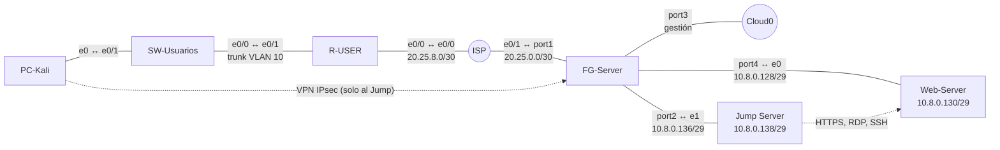
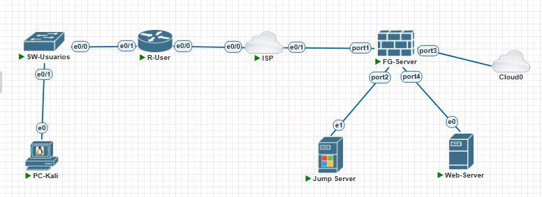
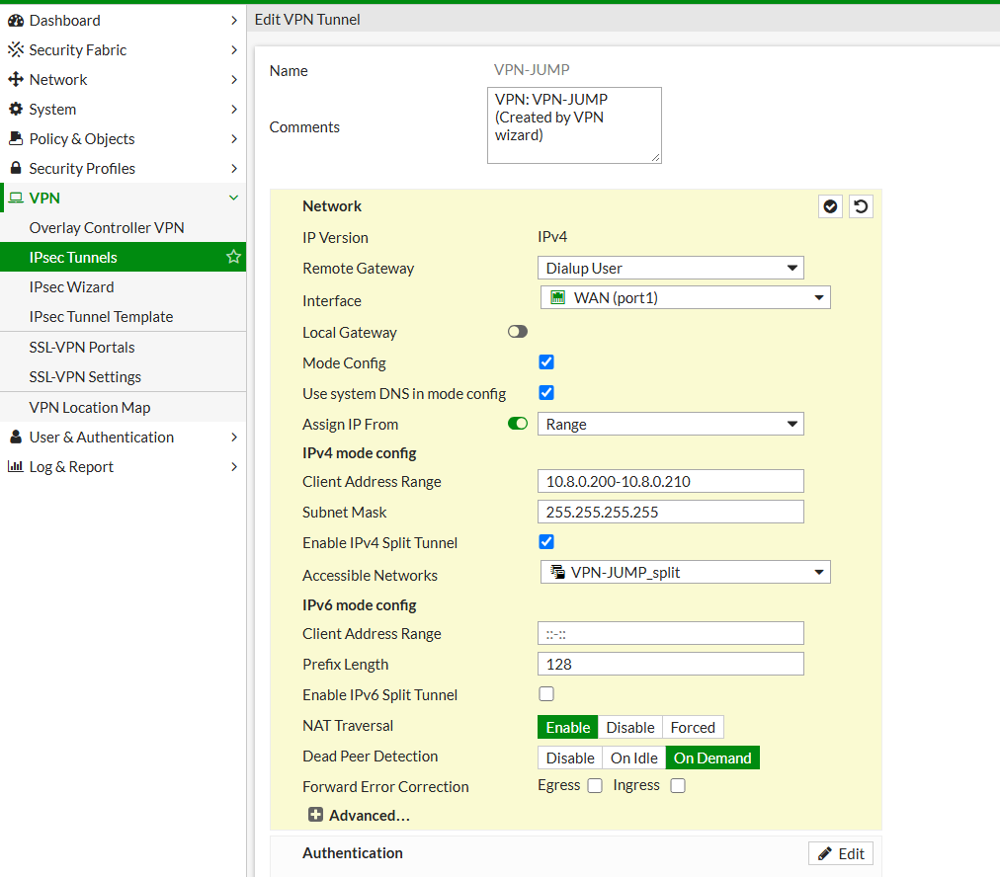
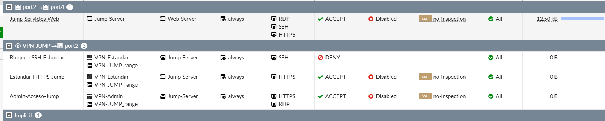
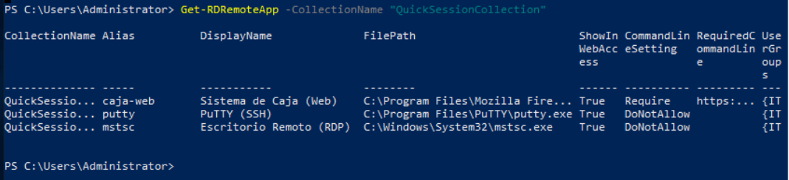
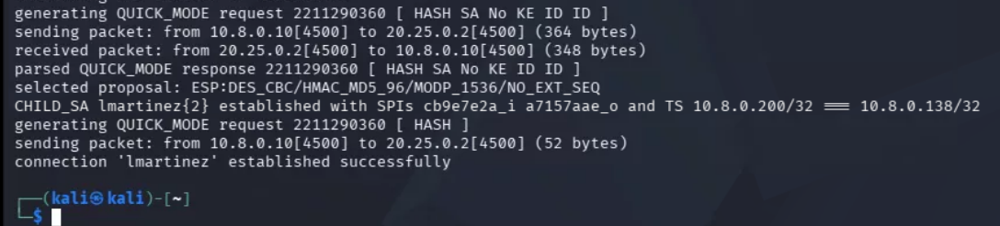
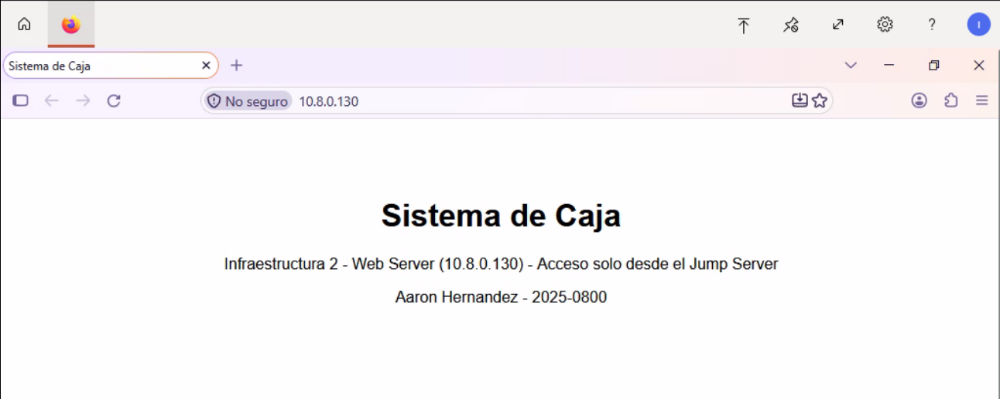
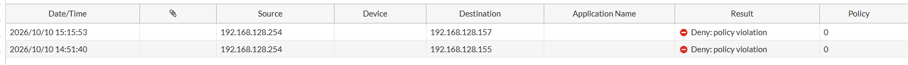
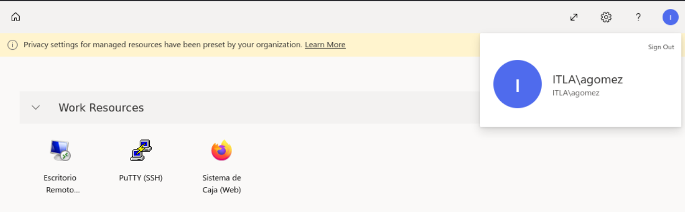
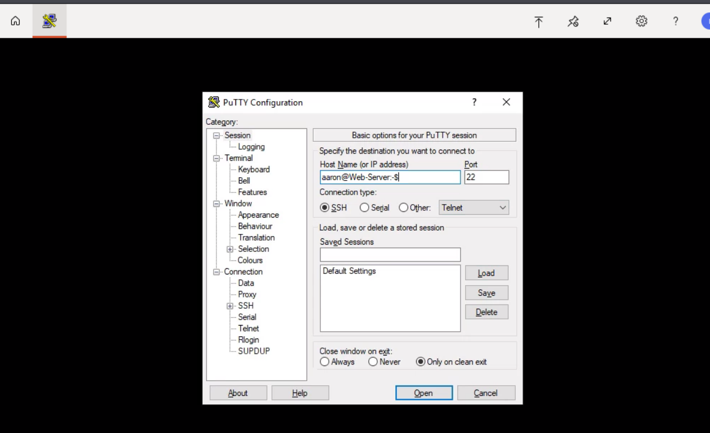

# Práctica 3 – Infraestructura 2: Jump Server con VPN de acceso remoto

## 🎥 Video de la demostración

**[agregar enlace del video aquí]**

---

**ITLA – Instituto Tecnológico de Las Américas**
**Estudiante:** Aaron Hernández · **Matrícula:** 2025-0800 · **Carrera:** Ciberseguridad
**Docente:** Jonathan Esteban Rondón Corniel

### 📂 Archivos

| Equipo | Configuración (comandos usados) | Running-config |
|---|---|---|
| ISP | [configs/ISP.txt](configs/ISP.txt) | [running-configs/ISP.txt](running-configs/ISP.txt) |
| SW-Usuarios | [configs/SW-Usuarios.txt](configs/SW-Usuarios.txt) | [running-configs/SW-Usuarios.txt](running-configs/SW-Usuarios.txt) |
| R-USER | [configs/R-USER.txt](configs/R-USER.txt) | [running-configs/R-USER.txt](running-configs/R-USER.txt) |
| FG-Server | [configs/FG-Server.txt](configs/FG-Server.txt) | [running-configs/FG-Server.txt](running-configs/FG-Server.txt) |
| Web-Server | [configs/Web-Server.txt](configs/Web-Server.txt) | — |
| Jump Server | [configs/Jump-Server.txt](configs/Jump-Server.txt) | — |
| PC-Kali | [configs/PC-Kali.txt](configs/PC-Kali.txt) | — |

---

## Contenido

1. [Propósito del laboratorio](#1-propósito-del-laboratorio)
2. [Topología y direccionamiento](#2-topología-y-direccionamiento)
3. [Cómo funciona](#3-cómo-funciona)
4. [Equipo de red](#4-equipo-de-red)
5. [FortiGate](#5-fortigate)
6. [Web Server](#6-web-server)
7. [Jump Server](#7-jump-server)
8. [Cliente (PC-Kali)](#8-cliente-pc-kali)
9. [Pruebas](#9-pruebas)
10. [Problemas encontrados](#10-problemas-encontrados)
11. [Limitaciones y mejoras](#11-limitaciones-y-mejoras)
12. [Running-configs y scripts](#12-running-configs-y-scripts)

---

## 1. Propósito del laboratorio

Demostrar un acceso seguro a servidores mediante un **Jump Server**. El usuario no llega directo a los servidores: primero se conecta por una **VPN IPsec de acceso remoto** al FortiGate, y esa VPN **solo le da acceso al Jump Server**. Desde ahí, con aplicaciones publicadas como **RemoteApp** en el **RD Web Client**, trabaja con el Web Server, al que el Jump Server solo puede llegar por **HTTPS, RDP y SSH**.

| Usuario | Tipo | Grupo FortiGate | Grupo AD | Apps que ve |
|---|---|---|---|---|
| Luis Martínez (`lmartinez`) | Sin privilegios | VPN-Estandar | RDS-Estandar | Solo la web (Sistema de Caja) |
| Ana Gómez (`agomez`) | Con privilegios | VPN-Admin | RDS-Admin | Web, PuTTY y Escritorio Remoto |

Al usuario sin privilegios se le bloquea el SSH con una **política explícita** que además queda registrada en el log. Toda la configuración del FortiGate se hizo por la GUI; por consola solo se puso la IP de gestión.

---

## 2. Topología y direccionamiento





| Segmento | Red | Gateway | Equipos |
|---|---|---|---|
| WAN R-USER | 20.25.8.0/30 | 20.25.8.1 (ISP) | R-USER .2 |
| WAN FortiGate | 20.25.0.0/30 | 20.25.0.1 (ISP) | FG-Server port1 .2 |
| VLAN 10 Usuarios | 10.8.0.0/25 | 10.8.0.1 (R-USER) | DHCP .10 a .100 |
| LAN-WEB (port4) | 10.8.0.128/29 | 10.8.0.129 | Web Server .130 |
| LAN-JUMP (port2) | 10.8.0.136/29 | 10.8.0.137 | Jump Server .138 |
| Pool de la VPN | 10.8.0.192/27 | — | .200 a .210, una IP /32 por cliente |
| Gestión FortiGate (port3) | 192.168.128.0/24 | — | 192.168.128.141 (Cloud0) |

| Equipo | Imagen |
|---|---|
| FG-Server | FortiGate VM64-KVM v6.4.0 (licencia de evaluación) |
| R-USER, ISP, SW-Usuarios | Cisco IOL |
| Web Server | Ubuntu Server 20.04 |
| Jump Server | Windows Server 2022 Standard Evaluation (Desktop Experience) |
| PC-Kali | Kali Linux 2026.2 |

> La licencia de evaluación del FortiGate solo permite **DES/MD5** en la VPN y un **máximo de 5 políticas**. Se usaron 4.

---

## 3. Cómo funciona

1. El Kali abre la VPN con **IKEv1 en modo agresivo + PSK** (NAT-T, UDP 4500).
2. El FortiGate pide usuario y clave (**XAuth**).
3. Le asigna una IP del pool (10.8.0.200 – .210) y una ruta solo hacia `10.8.0.138`.
4. El cliente entra por **HTTPS 443** al RD Web Client del Jump Server (todo pasa por el RD Gateway).
5. Desde el Jump Server, la RemoteApp llega al Web Server por HTTPS, RDP o SSH.


Como el Kali está detrás del R-USER (que hace NAT), el FortiGate ve al cliente como `20.25.8.2` y el túnel sale con **NAT-T por el puerto 4500**.

---

## 4. Equipo de red

Configuraciones: [ISP](configs/ISP.txt) · [SW-Usuarios](configs/SW-Usuarios.txt) · [R-USER](configs/R-USER.txt). Running-configs: [ISP](running-configs/ISP.txt) · [SW-Usuarios](running-configs/SW-Usuarios.txt) · [R-USER](running-configs/R-USER.txt).

- **SW-Usuarios:** VLAN 10, trunk hacia el R-USER solo con esa VLAN, y el puerto del PC en modo access con portfast. Los puertos sin uso están apagados.
- **R-USER:** router-on-a-stick con la subinterfaz `e0/1.10`, DHCP para la VLAN 10, NAT hacia el ISP y `ip tcp adjust-mss 1360` para que el tamaño de los paquetes no dé problemas con la VPN.
- **ISP:** solo conoce las dos WAN y un Loopback que simula Internet (`8.8.8.8`). No tiene rutas a las redes `10.8.0.x`, así que al Jump Server solo se llega por la VPN.

---

## 5. FortiGate

Comandos: [configs/FG-Server.txt](configs/FG-Server.txt) · Verificaciones: [running-configs/FG-Server.txt](running-configs/FG-Server.txt).

### 5.1 Interfaces y ruta

| Puerto | Alias | IP | Acceso administrativo |
|---|---|---|---|
| port1 | WAN | 20.25.0.2/30 | PING |
| port2 | LAN-JUMP | 10.8.0.137/29 | PING |
| port3 | (gestión) | 192.168.128.141/24 | PING, HTTPS, SSH, HTTP |
| port4 | LAN-WEB | 10.8.0.129/29 | PING |

Ruta por defecto `0.0.0.0/0` hacia `20.25.0.1` por el port1.

### 5.2 Objetos, usuarios y grupos

| Tipo | Nombre | Valor |
|---|---|---|
| Dirección | Jump-Server | 10.8.0.138/32 |
| Dirección | Web-Server | 10.8.0.130/32 |
| Dirección | VPN-JUMP_range | 10.8.0.200 – 10.8.0.210 |
| Grupo de direcciones | VPN-JUMP_split | Jump-Server |
| Usuario → grupo | `lmartinez` → VPN-Estandar | Sin privilegios |
| Usuario → grupo | `agomez` → VPN-Admin | Con privilegios |

### 5.3 VPN IPsec de acceso remoto (VPN-JUMP)

Se creó con **VPN > IPsec Wizard > Remote Access** y luego se convirtió en túnel personalizado para ajustarla:

| Parámetro | Valor |
|---|---|
| Tipo | Dial-up, IKEv1 en modo agresivo, por el port1 |
| Autenticación | Pre-shared key + XAuth |
| Grupo XAuth | **Inherit from policy** (cada política decide qué grupo entra) |
| Phase 1 / Phase 2 | DES / MD5, DH grupo 5, PFS |
| Phase 2 | Keepalive activo, keylife 43200 s, selectores 0.0.0.0/0 (el acceso lo limitan las políticas) |
| Pool | 10.8.0.200 – 10.8.0.210 |
| Split tunnel | Solo `Jump-Server` (10.8.0.138/32) |

Con el split tunnel, al cliente solo se le instala la ruta hacia el Jump Server.



### 5.4 Políticas

En el orden en que las evalúa el FortiGate:

| ID | Nombre | Origen → Destino | Grupo | Servicio | Acción |
|---|---|---|---|---|---|
| 3 | Bloqueo-SSH-Estandar | VPN-JUMP → Jump-Server | VPN-Estandar | SSH | **DENY** con log |
| 4 | Jump-Servicios-Web | Jump-Server → Web-Server | — | HTTPS, RDP, SSH | ACCEPT |
| 2 | Estandar-HTTPS-Jump | VPN-JUMP → Jump-Server | VPN-Estandar | HTTPS | ACCEPT |
| 1 | Admin-Acceso-Jump | VPN-JUMP → Jump-Server | VPN-Admin | HTTPS, RDP | ACCEPT |
| 0 | Implicit Deny | any → any | — | ALL | DENY con log |

- Ninguna política tiene NAT.
- **Bloqueo-SSH-Estandar** hace explícito el bloqueo del SSH y deja el registro. Sin ella la Implicit Deny también lo bloquearía, pero el log no diría a quién ni por qué.
- No hay política del Jump Server hacia Internet ni de la VPN directo al Web Server; eso lo bloquea la Implicit Deny.



---

## 6. Web Server

Ubuntu Server 20.04 con IP fija `10.8.0.130/29` (gateway `10.8.0.129`). Para instalar los paquetes se conectó un momento a Cloud0 y después se pasó al port4. Comandos: [configs/Web-Server.txt](configs/Web-Server.txt).

| Servicio | Detalle |
|---|---|
| HTTPS | Apache con certificado autofirmado (RSA 2048, SAN con la IP), página "Sistema de Caja" |
| SSH | OpenSSH, sin login de root |
| RDP | xrdp con escritorio XFCE |

---

## 7. Jump Server

Windows Server 2022 con IP `10.8.0.138/29`. Mientras se instalaba tuvo una segunda tarjeta en Cloud0 para descargar lo necesario; al final se deshabilitó. Comandos de PowerShell: [configs/Jump-Server.txt](configs/Jump-Server.txt).

- **Dominio:** `itla.local` (NetBIOS `ITLA`) con DNS escuchando solo en la `.138`.
- **Usuarios y grupos del dominio:** `lmartinez` en **RDS-Estandar** y `agomez` en **RDS-Admin**.
- **Programas:** Firefox y PuTTY (`mstsc` ya viene con Windows).
- **Remote Desktop Services (Quick Start):** colección `QuickSessionCollection`, solo para los dos grupos.
- **Licencias:** Por Usuario (el Web Client no funciona por dispositivo).
- **Certificado** autofirmado de `JUMP-SERVER.itla.local` para todos los roles de RDS y para el listener RDP.
- **RD Web Client (HTML5):** `https://jump-server.itla.local/RDWeb/webclient`.
- **RD Gateway:** así todo el acceso del cliente pasa por **HTTPS 443**.
- **Rutas estáticas hacia el FortiGate (`10.8.0.137`):** `10.8.0.128/29` y `10.8.0.192/27` (donde está el pool de la VPN), para que las respuestas a los clientes VPN regresen por el FortiGate.

| RemoteApp | Programa | Grupos |
|---|---|---|
| Sistema de Caja (Web) | Firefox → `https://10.8.0.130` | RDS-Estandar, RDS-Admin |
| PuTTY (SSH) | putty.exe | RDS-Admin |
| Escritorio Remoto (RDP) | mstsc.exe | RDS-Admin |



---

## 8. Cliente (PC-Kali)

Kali en la VLAN 10 con IP por DHCP del R-USER. El cliente VPN es **strongSwan 6.0.1**, con una conexión por usuario (`/etc/ipsec.conf`). Todos los comandos: [configs/PC-Kali.txt](configs/PC-Kali.txt).

```
conn base
    keyexchange=ikev1
    aggressive=yes
    ike=des-md5-modp1536!
    esp=des-md5-modp1536!
    left=%defaultroute
    leftauth=psk
    leftauth2=xauth
    leftsourceip=%config
    right=20.25.0.2
    rightid=%any
    rightauth=psk
    rightsubnet=10.8.0.138/32
    auto=ignore

conn lmartinez
    also=base
    leftid=@lmartinez
    xauth_identity=lmartinez
    auto=add

conn agomez
    also=base
    leftid=@agomez
    xauth_identity=agomez
    auto=add
```

La clave compartida y las contraseñas de XAuth van en `/etc/ipsec.secrets` y **no se suben al repositorio**. En `/etc/hosts` se agregó `10.8.0.138 jump-server.itla.local jump-server` para que el nombre del certificado coincida.

---

## 9. Pruebas

### 9.1 Usuario sin privilegios (lmartinez)

```bash
nc -zv -w 5 10.8.0.138 443         # sin VPN: timed out
sudo ipsec up lmartinez            # XAuth successful, IP 10.8.0.200
curl -k -s -o /dev/null -w "%{http_code}\n" https://jump-server.itla.local/RDWeb/webclient/   # 200
nc -zv -w 5 10.8.0.138 22          # timed out -> Bloqueo-SSH-Estandar
nc -zv -w 5 10.8.0.138 3389        # timed out -> Implicit Deny
nc -zv -w 5 10.8.0.130 443         # timed out -> la VPN solo llega al Jump
```



En el Web Client solo aparece **Sistema de Caja (Web)**. Al abrirla, el Firefox que corre en el Jump Server carga la página del Web Server:



El FortiGate registra el bloqueo con la política **Bloqueo-SSH-Estandar**:



### 9.2 Usuario con privilegios (agomez)

```bash
sudo ipsec up agomez
nc -zv -w 5 10.8.0.138 3389        # open
nc -zv -w 5 10.8.0.138 22          # timed out (ninguna política lo permite)
```

En el Web Client aparecen las tres apps:



| App | Destino | Resultado |
|---|---|---|
| Sistema de Caja (Web) | https://10.8.0.130 | Carga la página |
| PuTTY (SSH) | aaron@10.8.0.130 | Entra al Web Server |
| Escritorio Remoto (RDP) | 10.8.0.130 | Abre el escritorio XFCE |



---

## 10. Problemas encontrados

| Problema | Causa | Solución |
|---|---|---|
| strongSwan no mandaba usuario y clave por XAuth | La 6.1 de Kali ya no trae el plugin `xauth-generic` | Se instaló la 6.0.1 de Debian trixie y se dejó en `apt-mark hold` |
| El Web Client mostraba las apps, pero se cerraban al abrirlas | Sin RD Gateway la sesión iba por el puerto 3392 y fallaba con el certificado | Se agregó el rol **RD Gateway**; todo pasa por HTTPS 443 |
| Después de reiniciar, el Web Client no conectaba | El Connection Broker (Tssdis) no arrancaba solo, porque el servidor también es controlador de dominio | Arranque retrasado para Tssdis y la base WID |
| El RDP de Administrator era rechazado | Administrator no está en los grupos de la colección | Para administrar se entra con `mstsc /admin` |
| xrdp volvía al login después de poner la clave | Ubuntu solo deja abrir Xorg desde la consola física | `allowed_users=anybody` en `Xwrapper.config` |
| La VPN se cortaba después de la Phase 1 | La contraseña de XAuth del Kali no era la misma que la del usuario en el FortiGate | Se igualaron las dos contraseñas |

---

## 11. Limitaciones y mejoras

Es un laboratorio y algunas decisiones vienen de la licencia de evaluación. En un entorno real cambiaría:

- **Cifrado de la VPN:** DES/MD5 y DH 5 ya no son seguros. Usaría IKEv2 con AES-256, SHA-256 y DH 14 o superior.
- **Modo agresivo con clave compartida:** el hash de la PSK viaja en el intercambio y se puede atacar offline. Mejor IKEv2 con certificados, y MFA además de usuario y clave.
- **Jump Server:** hoy es a la vez controlador de dominio y servidor de RDS; en producción son equipos separados.

---

## 12. Running-configs y scripts

| Equipo | Configuración (comandos usados) | Running-config |
|---|---|---|
| ISP | [configs/ISP.txt](configs/ISP.txt) | [running-configs/ISP.txt](running-configs/ISP.txt) |
| SW-Usuarios | [configs/SW-Usuarios.txt](configs/SW-Usuarios.txt) | [running-configs/SW-Usuarios.txt](running-configs/SW-Usuarios.txt) |
| R-USER | [configs/R-USER.txt](configs/R-USER.txt) | [running-configs/R-USER.txt](running-configs/R-USER.txt) |
| FG-Server | [configs/FG-Server.txt](configs/FG-Server.txt) | [running-configs/FG-Server.txt](running-configs/FG-Server.txt) (verificaciones; las claves aparecen como `ENC <oculto>`) |
| Web-Server | [configs/Web-Server.txt](configs/Web-Server.txt) | — |
| Jump Server | [configs/Jump-Server.txt](configs/Jump-Server.txt) | — |
| PC-Kali | [configs/PC-Kali.txt](configs/PC-Kali.txt) | — |

> En el `show firewall policy` la política 3 no muestra `set action` porque `deny` es el valor por defecto.
